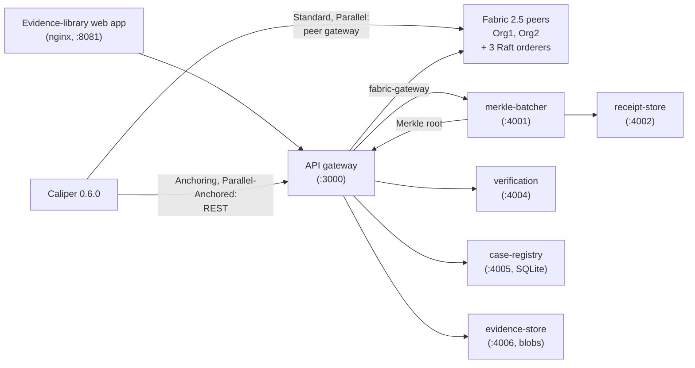
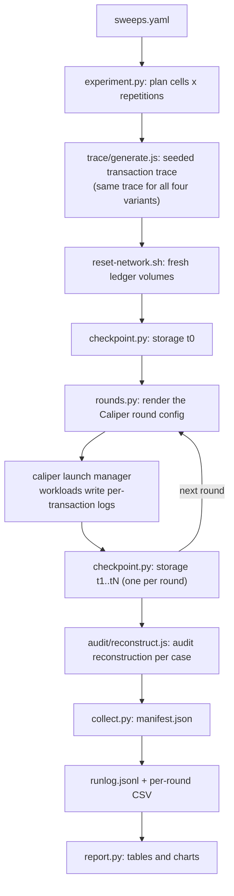

# GLEIPNIR

**A benchmark of four blockchain chain-of-custody architectures on Hyperledger Fabric 2.5.**

GLEIPNIR runs one digital-evidence chain-of-custody (CoC) application in four
ledger designs on the same single-host Fabric network. It drives each design
with the same seeded workload through Hyperledger Caliper and measures what the
design costs in throughput, latency, storage, and audit and verification time.
On top of the same API it ships a small evidence-library web app: cases,
evidence ingest, the custody trail, Merkle verification, and a per-case CoC
report.

The project was built for an undergraduate thesis in Cyber Security at BINUS
University. Everything runs locally in Docker. Nothing in it is
production-hardened.

- [The four variants](#the-four-variants)
- [Architecture](#architecture)
- [Requirements](#requirements)
- [Setup](#setup)
- [Quick start](#quick-start)
- [Running the benchmark](#running-the-benchmark)
- [Where the data goes](#where-the-data-goes)
- [Tests](#tests)
- [Repository layout](#repository-layout)
- [Troubleshooting and known limits](#troubleshooting-and-known-limits)

## The four variants

The variants form a 2 × 2 design: anchoring on or off, parallel channels on or off.

| | One shared channel | One channel per case |
|---|---|---|
| **One transaction per event** | **Standard** | **Parallel** |
| **Events batched off-chain, Merkle root on-chain** | **Anchoring** | **Parallel-Anchored** |

- **Standard**: every custody event is one transaction on the shared channel
  `coc-main`. This is the reference design.
- **Anchoring**: events go to an off-chain Merkle batcher. Only each batch's
  SHA-256 Merkle root and some metadata are committed on `coc-main`. Each event
  keeps a receipt (leaf hash, sibling path, and a copy of the event) in the
  receipt store, so it can later be verified against the on-chain root.
- **Parallel**: one Fabric channel per case (`case-001`, `case-002`, ...), one
  transaction per event.
- **Parallel-Anchored**: per-case channels plus per-case Merkle batching. Each
  case's roots are committed on that case's own channel.

The variant changes only how audit events reach the ledger. The chaincode
interface, the client API, the transaction trace and the Caliper workload
modules are the same for all four, so the results compare like for like. All
ledger writes use one chaincode package and one endorsement policy on the
application channels. Evidence files are always stored off-chain; the ledger
records only their integrity proof (a hash).

In the design of the five published campaigns, Parallel-Anchored committed its
roots to a separate anchor channel (`anchor-main`) through an extra
anchor-client service. That design is git commit `573017b`.

The chaincode has four operations: `CreateEvidence`, `TransferCustody`,
`AccessLog` and `DisposeEvidence`. Each audit event is written under its own
composite key (evidence id plus the transaction's timestamp and id) instead of
into one shared record, so concurrent access-log writes to the same evidence
item never conflict. Conflict avoidance is structural; there are no
client-side retries.

## Architecture



| Component | Role |
|---|---|
| Fabric network | Fabric 2.5.15, two peer organizations, three etcdraft orderers, GoLevelDB world state. Channels are created with the channel-participation API (`osnadmin channel join`). Each organization's peer is its anchor peer on every channel, so a 2-of-2 endorsement policy can be used. |
| Chaincode | Go chaincode, run as an external service (chaincode-as-a-service). |
| API gateway | Node.js backend-for-frontend. The web app and the REST workloads reach Fabric only through it. It routes each write by variant, commits the anchored variants' Merkle roots, and holds the web app's user sessions and roles. |
| Off-chain services | merkle-batcher, receipt-store, verification (anchored variants); case-registry and evidence-store (evidence library). |
| Web app | React + Vite single-page app behind nginx; talks only to the gateway. |
| Benchmark | Caliper 0.6.0 workspace: seeded trace generator, workload modules, a REST connector, per-transaction logging, the audit-reconstruction harness. |
| Orchestration | Bash scripts for the network lifecycle, a Python experiment driver, metric collection and reporting, and a Windows desktop app that drives it all. |

The full design is in [docs/ARCHITECTURE.md](docs/ARCHITECTURE.md), the exact
interfaces (ports, schemas, the Merkle spec, environment variables) in
[docs/CONTRACTS.md](docs/CONTRACTS.md), and the system as built in
[docs/AS-BUILT.md](docs/AS-BUILT.md). Every module has its own README.

## Requirements

**Host.** Ubuntu 22.04 LTS, or Windows 11 with WSL2. On Windows the scripts run
inside a WSL distro, and the desktop app expects that distro to be named
exactly `Ubuntu-22.04`. Docker Desktop needs WSL integration enabled for it.

**Software (on the Linux side).**

| Tool | Version | Used for |
|---|---|---|
| Docker Engine + Compose v2 | tested with 29.5.2 | the whole stack |
| bash, curl, jq | any recent | orchestration scripts |
| `fabric-ca-client` | 1.5.19 | crypto enrollment (`up.sh`) |
| Node.js | 20.19 | Caliper and the benchmark tools |
| Python | 3.10 or later, with PyYAML | experiment driver, collection, reports |
| matplotlib | optional | charts in `report.py` |
| openpyxl | optional | the pooled Excel workbook (`present.py`) |

Go 1.25.5 is needed only to run the chaincode unit tests outside Docker; the
chaincode image builds with its own pinned toolchain.

**For the Windows desktop app:** Python 3.11 on Windows with tkinter and
PyYAML (matplotlib for charts).

**Hardware.** One fully loaded channel needs about one CPU core, so the core
count limits how many channels the Parallel variants can use (E2's channel grid
goes up to 50; E3c's top cell runs 100 channels at 5 tx/s each, about 4 cores and
up to about 5 GB of Fabric memory). The published campaigns ran in a WSL2 VM with 32 cores and
about 10 GB of memory. Each of them was about 150 runs and about 30 hours of
run time; a campaign of the current experiment set is 246 runs (12 of them E3a
climb runs), roughly 59 hours. `experiment.py --dry-run`
prints an estimate for each plan from the run times already logged.

**Pinned images and libraries** (change none of them; `:latest` Fabric images
are Fabric 3.x):

| Component | Version |
|---|---|
| Hyperledger Fabric | 2.5.15 |
| Fabric CA | 1.5.19 |
| Hyperledger Caliper | 0.6.0, bound as `fabric:fabric-gateway` |
| Client library | `@hyperledger/fabric-gateway` |
| Node.js | 20.19 |
| Go (chaincode) | 1.25.5 |
| World state | GoLevelDB (no CouchDB) |

## Setup

Run everything below in a Linux shell (on Windows: the `Ubuntu-22.04` WSL
distro). On Windows, clone the repository onto a Windows drive (for example
`C:\GLEIPNIR`, which WSL sees as `/mnt/c/GLEIPNIR`), because the desktop app
maps Windows paths to `/mnt/<drive>/...`.

1. **Clone the repository.**

   ```bash
   git clone https://github.com/theflorist18/GLEIPNIR.git
   cd GLEIPNIR
   ```

2. **Install `fabric-ca-client` 1.5.19.** The simplest way is to copy it out of
   the pinned Fabric CA image:

   ```bash
   docker create --name fabric-ca-tmp hyperledger/fabric-ca:1.5.19
   docker cp fabric-ca-tmp:/usr/local/bin/fabric-ca-client .
   docker rm fabric-ca-tmp
   sudo install fabric-ca-client /usr/local/bin/ && rm fabric-ca-client
   fabric-ca-client version
   ```

   The Fabric CA 1.5.19 release binaries from the Hyperledger GitHub releases
   work as well.

3. **Install the Caliper workspace and bind it.** The binding string is part of
   the measurement setup; use exactly this one.

   ```bash
   cd benchmark
   npm install
   npm run bind        # npx caliper bind --caliper-bind-sut fabric:fabric-gateway
   cd ..
   ```

4. **Install the Python dependencies.**

   ```bash
   pip install -r orchestration/requirements.txt   # PyYAML
   pip install matplotlib openpyxl                 # optional: charts, Excel workbook
   ```

5. **Review `network/compose/.env`.** It holds the pinned image tags and
   development defaults for the service token (`GLEIPNIR_TOKEN`), the internal
   service secret (`GLEIPNIR_INTERNAL_TOKEN`) and the first web-app admin
   account (`ADMIN_USERNAME`, `ADMIN_PASSWORD`). Change the secrets before you
   run the stack anywhere but your own machine. The scripts write `VARIANT`,
   `ENDORSEMENT`, `BATCH_*` and `CCAAS_ID_*` themselves; do not edit those by
   hand.

6. **Images.** `up.sh` builds the service images on first start with Docker
   Compose. Behind a TLS-intercepting proxy the builds cannot fetch packages;
   in that case build them once with your proxy's CA bundle (it is injected at
   build time only and never enters the repository):

   ```bash
   GLEIPNIR_CA_BUNDLE=/path/to/proxy-ca.crt bash orchestration/build-images.sh
   ```

## Quick start

Start one variant, then run the end-to-end smoke test:

```bash
bash orchestration/up.sh --variant standard
bash orchestration/smoke-standard.sh    # create -> transfer -> access x2 -> audit trail -> dispose
```

`up.sh` enrolls the crypto material, starts the orderers, peers and CAs,
waits until both peers serve gRPC, creates the channels (and checks for HTTP
201 from all three orderers), deploys the chaincode, and starts the off-chain
services the variant needs.

| Variant | Command |
|---|---|
| Standard | `bash orchestration/up.sh --variant standard` |
| Anchoring | `bash orchestration/up.sh --variant anchoring` |
| Parallel | `bash orchestration/up.sh --variant parallel --channels 10` (channels `case-001` ... `case-010`) |
| Parallel-Anchored | `bash orchestration/up.sh --variant parallel-anchored --channels 10` |

`--endorsement all` commits the chaincode with a 2-of-2 policy (a peer of each
organization must endorse); the default, `any`, needs one peer of either.

Once the stack is up:

- **Web app:** <http://localhost:8081>. Log in with `ADMIN_USERNAME` /
  `ADMIN_PASSWORD` from `network/compose/.env` and create users on the admin
  pages. Roles are admin, lead and investigator; leads create cases and manage
  who works on them.
- **API:** <http://localhost:3000> (`GET /healthz`; endpoints in
  [gateway/README.md](gateway/README.md) and
  [docs/CONTRACTS.md](docs/CONTRACTS.md) §6).
- **Evidence-library smoke test:** `bash orchestration/smoke-library.sh`
  (login, roles, case, multipart ingest, search, automatic access logging,
  authorization checks).
- **On Windows:** double-click `GLEIPNIR Web.cmd` in the repository root. It
  starts Docker Desktop and the existing stack if needed, then opens the web
  app.

Stop the stack:

```bash
bash orchestration/down.sh           # stops every container, keeps all volumes
bash orchestration/down.sh --wipe    # ALSO deletes every volume (ledgers, accounts, cases, evidence) and the crypto material
```

`--wipe` cannot be undone. Back up first if anything on the stack matters:
`bash orchestration/backup-volumes.sh <dir>`. To restore, stop the stack and
run `bash orchestration/backup-volumes.sh <dir> --restore`.

To start a stopped stack again, do not run `up.sh` (it would re-create
channels the ledger already holds). Start the existing containers instead:

```bash
source orchestration/lib.sh && compose up -d --no-build    # add --profile anchoring or --profile parallel-anchored for those variants
```

## Running the benchmark

### How a run works

All experiment constants live in one file,
[benchmark/sweeps.yaml](benchmark/sweeps.yaml): the factor grids, the
calibrated baseline values, and the controlled workload (seed, workers,
repetitions, workload mix, payload size, and so on).
`orchestration/experiment.py` turns an experiment into a plan of cells ×
repetitions, and every run gets a fresh network:



A fresh ledger per run matters for validity: the trace replays deterministic
evidence ids, so a second run on the same ledger would duplicate
`CreateEvidence` and start its storage series dirty. The reset removes only
the ledger, receipt and verification-metrics volumes, never the evidence
library's accounts, cases or files. Because it deletes ledgers, it refuses to
run unless `GLEIPNIR_ALLOW_LEDGER_WIPE=1` is set.

Each run records its provenance in `run.json`: the git commit, the blob SHAs of
the network configuration files and of `sweeps.yaml`, the trace hash and
parameters, the Caliper and Fabric versions, and the host's cores and memory.
It also records the run's controls, including the batch timers and the
endorsement policy.

### Experiments

Run them in this order; each calibration step fills a `baseline` value in
`sweeps.yaml` that the later experiments use. The baselines are already set
(from the first published campaign), so a campaign of the current design runs
`e1`, `e3a`, `e3b`, `e3c`, `ops` and `sens`; `ramp` and `e2` stay available.

| `--exp` | Variants | Varies | Purpose |
|---|---|---|---|
| `e0` | all four | nothing | Functional smoke test of every operation, labelled `smoke`; never a performance result. |
| `ramp` | all four | send rate | Finds a sub-saturation send rate: suggests `baseline.send_rate_tps`. |
| `e1` | Anchoring, Parallel-Anchored (+ Standard and Parallel reference runs) | batch size | Batch-size calibration: suggests `baseline.batch_size`. |
| `e2` | Parallel | channel count | Channel-count calibration: suggests `baseline.channels` (the median of the healthy range) and `baseline.channels_max` (100 since campaign 6's E3c re-run; applying E2's suggestion would set it back to E2's top). |
| `e3a` | all four | send rate | Scalability against load: one round per send rate from 100 tx/s up to a common top of 2,500 tx/s for every variant (16 Caliper workers): all four run the same 14 send rates. |
| `e3b` | all four | case count | Scalability against the number of cases at a fixed total send rate: the cost of adding channels (one channel per case on the Parallel variants). |
| `e3c` | all four | case count | The same at a fixed send rate per case (5 tx/s), so the load grows with the cases: 5 to 100 cases, 25 to 500 tx/s. |
| `ops` | all four | operation type | Per-operation breakdown at the E3 operating point: writes, reads, and (anchored variants) verification. |
| `sens` | all four (the idle-timer cell: anchored variants) | the cell | Sensitivity cells at the baseline point: a baseline cell, 2-of-2 endorsement and a 5 s idle batch timer, run repetition by repetition. |
| `cell` | all four, or `--variant` | your own levels | One ad-hoc cell at the factor levels you pass; a probe, not an E1–E3 data point. |

E3a judges each send rate on the finalized throughput (below) and writes its
progress, per variant, to `benchmark/results/e3a/e3a-climb.json` after every
step; the rule is in docs/methodology/experiments.md §4.5.

Every cell runs `repetitions` times (3 by default; results are mean ± SD). Only
runs with at least 10³ write events per channel are labelled `steady` and used
for performance claims; shorter runs are labelled `sub-floor`. The reasoning
behind the design, the level-selection rules and the threats to validity are
in [docs/methodology/experiments.md](docs/methodology/experiments.md).

### Commands

```bash
# Back up anything you want to keep: every run resets the ledger.
bash orchestration/backup-volumes.sh backups/before-e1

# Print the plan and an ETA without touching Docker.
python3 orchestration/experiment.py --exp e1 --dry-run

# Run an experiment; --resume continues after an interruption.
GLEIPNIR_ALLOW_LEDGER_WIPE=1 python3 -u orchestration/experiment.py --exp e1
GLEIPNIR_ALLOW_LEDGER_WIPE=1 python3 -u orchestration/experiment.py --exp e1 --resume

# One quick, light probe of a single variant.
GLEIPNIR_ALLOW_LEDGER_WIPE=1 python3 -u orchestration/experiment.py --exp cell \
  --variant parallel --reps 1 --send-rate 25 --cases 5 --rounds 2 --events-per-case 40

# Tables (CSV + Markdown, mean ± SD) and charts.
python3 orchestration/report.py --exp e1        # writes docs/results/e1/
```

Other useful flags: `--variant V` (repeatable), `--reps N`, `--no-monitor`,
`--no-audit`, `--verbose` (show Caliper's full output), `--sweeps FILE` (use
another constants file; its SHA is recorded). For `--exp cell`, the factor
flags are `--send-rate R [R ...]`, `--batch-size B` and `--cases N`, and the
workload and run settings can be changed per run (`--seed`, `--workers`,
`--rounds`, `--events-per-case`, `--payload-bytes`, `--idle-timeout-ms`,
`--endorsement any|all`, ...). A changed workload is recorded in
`run.json` under `overrides` and gets its own results directory, so it never
mixes with the defaults. `python3 orchestration/experiment.py --help` lists
everything.

While it runs, the driver prints one line per run (`[run i/n | x % done |
elapsed | ETA]`) and one result line per round (successes, failures, throughput,
latency). Caliper's full log is kept in each round's `caliper.log`.

### Desktop app (Windows)

`orchestration/benchapp.pyw` is a Tkinter front end for the same driver.
Double-click it, or run `pyw -3.11 orchestration\benchapp.pyw`. It runs
`experiment.py` inside the `Ubuntu-22.04` WSL distro and gives you:

- an input box for the workload, grid and baseline values of `sweeps.yaml`
  and for the E3a base ladder (the E3a ratios and climb rule, `e3c`,
  `sensitivity` and `endorsement` are edited in the file), and one tab per
  experiment;
- Preview (the dry-run plan), Run, Resume and Cancel;
- a live panel with the current run, round and per-round results;
- the run history, CSV export, and table and chart generation;
- suggested baselines from the calibration rules, written to `sweeps.yaml`
  only when you click "Use as baseline";
- an automatic backup of every Docker volume (and `.env`) before each run, plus
  "Restore my test data".

## Where the data goes

```
benchmark/results/
  runlog.jsonl                              one line per run: id, experiment, variant, levels, status, wall time
  <exp>/<exp>-results.csv                   per-round export for Excel, rewritten after every run
  e3a/e3a-climb.json                        E3a: the rule and every variant's points, verdict and next step
  <exp>/<variant>/<levels>/r<rep>/          one directory per run, e.g. e1/anchoring/batch50-ch1-cases20/r1/
    run.json                                identity, controls and provenance
    rounds/<label>/                         bench.yaml, round.json, caliper.log, report.html, tx-w<i>.jsonl
    checkpoints.jsonl                       storage checkpoints t0..tN
    anchoring.json                          batcher status after the final flush, with each event's enqueue time (anchored variants)
    audit.json                              audit-reconstruction result
    manifest.json                           every metric of the run (what report.py reads)
  benchapp-logs/                            raw logs of runs started from the desktop app
benchmark/traces/<hash>.json                generated transaction traces
docs/results/<exp>/                         report.py output: CSV + Markdown tables, PNG charts (e3a also e3a-saturation.json)
backups/<timestamp>/                        desktop-app volume backups
```

`benchmark/results/`, `benchmark/traces/` and `backups/` are not committed.
The result tables of the five published campaigns are kept in
`docs/results/campaign<N>-<date>/`, and `orchestration/present.py` writes the
pooled workbook (every cell's mean ± SD over its 15 runs) to
`docs/results/pooled-c1-c5/`.

What `manifest.json` reports per run and per round:

- **Throughput**, successful transactions only (Caliper's own TPS counts failures
  too), and per channel on the Parallel variants. "Send rate" is the configured
  input; "throughput" is the measured output.
- **Latency**: min, average and max from Caliper, plus p50, p95 and p99 from
  the per-transaction logs, per round and per operation type. For the anchored
  variants a REST write is acknowledged (HTTP 202) when the event is queued, so
  their write latency is acceptance latency.
- **Finalization**: the **integrity finalization latency** runs from submission
  to the commit that protects the event (its own commit, or the commit of its
  batch's Merkle root), and the **finalized throughput** counts finalizations
  per second while the load is still being sent. These two compare all four
  variants on one basis. The **anchoring delay** (batcher enqueue until root
  commit) is reported too, per batch and per event.
- **Failures**: success and failure counts, failure rate, and the classes
  `MVCC_READ_CONFLICT`, `ENDORSEMENT_POLICY_FAILURE`, `TIMEOUT`, `HTTP_4XX`,
  `HTTP_5XX`, `OTHER`.
- **Resources**: CPU (%) and memory (MB) per container, grouped as Fabric,
  off-chain and all.
- **Storage**: block store per channel, GoLevelDB state and receipt store,
  measured with `du` on named Docker volumes at every checkpoint; bytes per
  event from a linear regression over the checkpoints.
- **Audit**: reconstruction time per case and per event (fetch every evidence
  trail, verify every event's Merkle branch, read each root once; every case of
  the run is audited), and for the anchored variants the verification latency
  of single events.

The full metric definitions are in [orchestration/README.md](orchestration/README.md)
and [docs/CONTRACTS.md](docs/CONTRACTS.md) §10.

## Tests

None of these need a running network:

```bash
(cd gateway && npm install && npm test)
for s in services/*/; do (cd "$s" && npm install && npm test); done
(cd benchmark && npm test)
(cd frontend && npm install && npm test)
(cd chaincode/evidence && go test ./...)
python3 orchestration/test_experiment.py
python3 orchestration/test_benchapp.py
python3 orchestration/collect.py --selftest
python3 orchestration/experiment.py --exp e3a --dry-run
```

With a stack up: `bash orchestration/smoke-standard.sh` and
`bash orchestration/smoke-library.sh`, or `--exp e0` for all four variants.

With an anchored stack up (Anchoring, or Parallel-Anchored with channel
`case-001`), two fault-injection checks show documented limits of the design.
They are functional checks, not benchmark runs; `--out FILE` saves the JSON
result, and each exits 0 when every outcome is the documented one:

```bash
bash orchestration/crash-test.sh     # events accepted (HTTP 202) are lost when the batcher crashes before their batch closes
bash orchestration/tamper-test.sh    # what a changed, deleted or replayed receipt does to verification and to the trail
```

## Repository layout

| Path | Contents |
|---|---|
| [`network/`](network/README.md) | Fabric configuration (`configtx.yaml`, `core.yaml`, `orderer.yaml`), CA enrollment, Docker Compose files and `.env` |
| [`chaincode/evidence/`](chaincode/evidence/README.md) | Go chaincode: the four custody operations and the anchor-root operations |
| [`gateway/`](gateway/README.md) | API gateway: REST API, sessions and roles, variant routing |
| [`services/merkle-batcher/`](services/merkle-batcher/README.md) | Batches events off-chain and builds the Merkle trees |
| [`services/receipt-store/`](services/receipt-store/README.md) | Stores each event's receipt (leaf hash, sibling path, event copy) |
| [`services/verification/`](services/verification/README.md) | Verifies one event: fetch, recompute the branch, compare with the on-chain root |
| [`services/case-registry/`](services/case-registry/README.md) | Evidence library: cases, participants, categories, evidence index (SQLite) |
| [`services/evidence-store/`](services/evidence-store/README.md) | Evidence library: immutable evidence files and their integrity proofs |
| [`frontend/`](frontend/README.md) | React + Vite evidence-library web app |
| [`benchmark/`](benchmark/README.md) | Caliper workspace: `sweeps.yaml`, trace generator, workloads, REST connector, audit harness |
| [`orchestration/`](orchestration/README.md) | Network lifecycle scripts, experiment driver, collection, reports, desktop app |
| `docs/` | Architecture, interface contracts, as-built description, methodology, version research, results |

## Troubleshooting and known limits

- **`reset-network.sh` exits with code 2**: set `GLEIPNIR_ALLOW_LEDGER_WIPE=1`.
  The guard exists because the reset deletes ledger volumes.
- **Builds fail behind a corporate or antivirus proxy**: use
  `orchestration/build-images.sh` with your proxy's CA bundle (see Setup).
  Afterwards check that the Node images really contain their dependencies:
  npm can exit 0 with an empty `node_modules` when TLS fails.
- **Do not start a stopped stack with `up.sh`**: it re-creates channels that
  the ledger already holds. Restart the existing containers with the
  `compose up -d --no-build` command under [Quick start](#quick-start)
  (`GLEIPNIR Web.cmd` and the desktop app do this for you).
- **WSL2 clock**: in the published campaigns the WSL2 VM clock drifted and
  stepped during long runs, which affects measured latencies. Compare
  latencies only between runs made under the same conditions.
- **Caliper throughput**: Caliper 0.6.0 counts failed transactions in its TPS
  figure; GLEIPNIR reports successful-only throughput instead. The Caliper
  peer-gateway connector records no error text for failed Fabric
  transactions, so their failure classes come from a scan of `caliper.log`.
- **Batcher crash**: on the anchored variants an event accepted with HTTP 202
  waits in the batcher's memory until its batch closes. If the batcher dies
  before that, the event is lost: no receipt, no trail entry, no root
  (`orchestration/crash-test.sh` shows it).
- **Endorsement**: the default 1-of-any policy lets one organization endorse
  alone. It isolates the cost of each architecture; it is not a production
  policy. `--endorsement all` gives 2-of-2.
- **Security**: the tokens and passwords in `.env` are development defaults,
  the receipt store is intentionally not hardened (its weaker integrity
  guarantee is one of the measured properties), and everything runs on one
  host. Do not expose the stack to a network you do not trust.

## License

No license has been chosen yet. Until a `LICENSE` file is added, all rights
are reserved by the authors.
