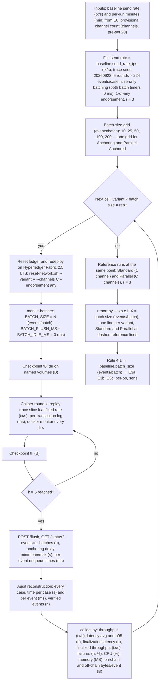
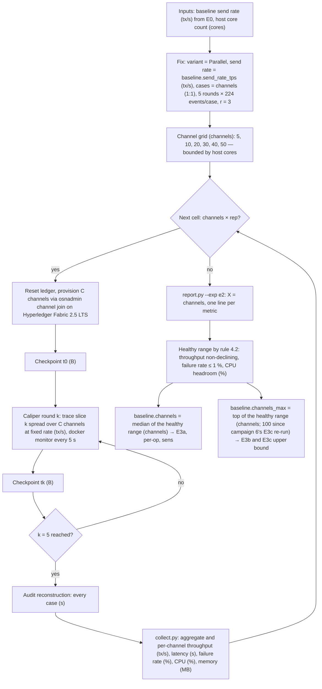
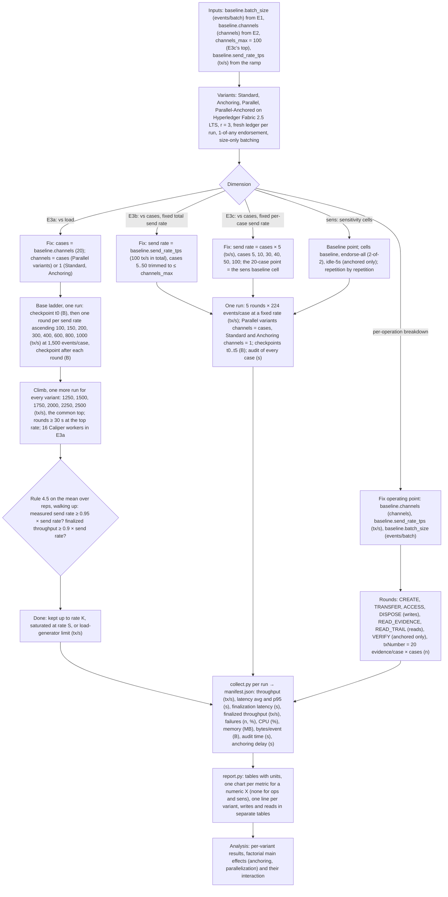

# GLEIPNIR — Experimental Methodology (E0–E3)

Paper-facing methodology layer for the M26 experimental redesign. Derived from the
supervisor's review (2026-09-22). Every constant named here lives in
`benchmark/sweeps.yaml` (single source of truth); every rule here is what
`orchestration/experiment.py`, `collect.py` and `report.py` implement. The `baseline.*`
values were filled from measured results (§4; `sweeps.yaml` records when and how each was
set); decisions marked **confirm with the supervisor** are documented defaults (§8), not
settled facts.

**M28** (the supervisor's review of the paper, 2026-11-06; approved by the authors the same
day) revises the design for the campaigns from campaign 6 on: a true 2×2 (§1), integrity
finalization as the latency all four variants share (§2.3), E3a up to saturation (§4.5), two
case scenarios (E3b, E3c) and the sensitivity cells (§3). The ramp and E2 are not re-run;
their baselines carry over. Campaigns 1–5 used the earlier design (git commit `573017b`);
where a section still describes it, it says so.

Terminology used throughout: *send rate* = the configured offered load (input);
*throughput* = committed transactions per second as measured (output); *TPS* / *tx/s*
is a unit only; *baseline* = the calibrated value carried forward (never "best");
*acceptance* = the gateway's HTTP 202 for an anchored write (the event is in an open
batch); *finalization* = the event is protected by the ledger (its own commit, or the
commit of its batch's Merkle root); *anchor channel* = the separate channel (`anchor-main`)
that received Parallel-Anchored's Merkle roots in the earlier design (campaigns 1–5). Since
M28 there is no anchor channel: every root is committed on an application channel.

---

## 1. Experimental frame — a 2×2 factorial

| | Parallelization **off** (one shared channel) | Parallelization **on** (one channel per case) |
|---|---|---|
| Anchoring **off** (one transaction per event) | **Standard** | **Parallel** |
| Anchoring **on** (events batched off-chain, Merkle root on-chain) | **Anchoring** (one shared batch scope; roots on the shared channel) | **Parallel-Anchored** (one batch scope per case; each root on the case's own channel) |

Factor A = Anchoring {off, on}; Factor B = Parallelization {off, on}. The variant
changes *only how audit events reach the ledger*; chaincode interface, gateway API,
transaction trace and Caliper workload modules are identical across the four cells.
Results are reported per variant and, where the design allows, as factorial main
effects (anchoring, parallelization) and their interaction.

Each factor means the same at both levels of the other. Anchoring: one transaction per
event, or one Merkle root per batch. Parallelization: one shared channel, or one channel per
case; on the anchored variants the channel is also the batch scope, so a root on `case-NNN`
covers only that case's events. All ledger writes (event records and roots) use one
chaincode package and one endorsement policy on the application channels; the batcher
submits every root through the gateway, which commits it on the channel that holds its
scope (`variantRouter.rootChannel`). In the earlier design (campaigns 1–5) Parallel-Anchored
batched per case but committed every root to the anchor channel through a separate
anchor-client under its own MSP (AnchorClientMSP). Its case channels carried nothing, so the
2×2 was not a true factorial. M28 removed that path (authors, 2026-11-06).

What the code enforces (a violation aborts the run):

| Constraint | Enforced by |
|---|---|
| Batch size is **identical** across the two A-on variants (one grid `batch_sizes`, one `baseline.batch_size`) | `experiment.py` reads a single key; merkle-batcher env `BATCH_SIZE` |
| Channel count is **identical** across the two B-on variants (`baseline.channels`) | `experiment.py` plan; `reset-network.sh --channels C` |
| Standard and Anchoring are **single-channel** (`channels = 1`, all cases route to the shared channel) | `experiment.py` forces `channels=1` for both |
| Same transaction sequence in every cell — only the channel routing key `case-NNN` differs | seeded trace `benchmark/trace/generate.js`; `trace.hash` in `run.json` |
| One endorsement policy for the chaincode on every application channel of a run (`endorsement.policy`: `any` by default, `all` only in the sensitivity cell `endorse-all`) | `orchestration/lib.sh` `endorsement_policy`; `reset-network.sh --endorsement`; `run.json controls.endorsement`; `--reuse-network` refuses a stack with another policy |

---

## 2. Variables

### 2.1 Independent variables (swept)

| Variable | Unit | Levels (`sweeps.yaml` key) | Swept in | Fixed in |
|---|---|---|---|---|
| Architecture variant | — | Standard, Anchoring, Parallel, Parallel-Anchored | E3a, E3b, E3c, per-op breakdown, sens | E1 (Anchoring, Parallel-Anchored, + Standard/Parallel reference runs); E2 (Parallel only) |
| Send rate (configured offered load) | tx/s | E3a: base ladder 100, 150, 200, 300, 400, 600, 800, 1000 (`e3a.send_rates_tps`), then the climb (§4.5); E3c: cases × 5 (`e3c.send_rate_per_case_tps`); ramp: 10, 25, 50, 75, 100, 150, 200 (`send_rates_tps`) | E3a, E3c, ramp | E1, E2, E3b, per-op, sens: `baseline.send_rate_tps` = 100 (sub-saturation, from the ramp) |
| Channel count | channels | 5, 10, 20, 30, 40, 50 (`channel_counts`; bounded by host cores) | E2 (Parallel) | E3a, per-op, sens, ramp, E1: `baseline.channels` = 20 (E2 median; campaign 1 ran the ramp and E1 at the same key's pre-set provisional value, 20, before E2 set the same value); Standard and Anchoring: always 1 |
| Case count | cases | E3b: 5, 10, 20, 30, 40, 50 (`case_counts`); E3c: 5, 10, 30, 40, 50, 100 (`e3c.case_counts`); both trimmed to ≤ `baseline.channels_max` = 100 | E3b, E3c | elsewhere `cases = channels` (1:1); the same case count for every variant in a cell |
| Batch size (N = K) | events/batch | 10, 25, 50, 100, 200 (`batch_sizes`, one grid for both anchored variants) | E1 | E3a, E3b, E3c, per-op, sens: `baseline.batch_size` = 50; not applicable to Standard and Parallel |
| Endorsement policy | — | `any` = `OR('Org1MSP.peer','Org2MSP.peer')` (1-of-any), `all` = `AND('Org1MSP.peer','Org2MSP.peer')` (2-of-2) (`endorsement.policy`) | sens (cell `endorse-all`) | everywhere else: `any` |
| Idle batch timer | ms | 0 (off), 5000 (`anchoring.idle_timeout_ms`) | sens (cell `idle-5s`, anchored variants only) | everywhere else: 0 (size-only batching) |

### 2.2 Controlled variables (fixed and recorded in every `run.json`)

| Quantity | Value | Unit | Source of record |
|---|---|---|---|
| Workload mix | CREATE = 1 per evidence; remaining events TRANSFER 0.15 / ACCESS 0.85; DISPOSE ends 0.5 of evidence | fraction | `workload.mix` |
| PRNG seed and trace | seed 20260922, mulberry32; trace pre-generated and replayed identically in all variants | — | `seed`; `run.json trace.hash` + params |
| Trace head-op spacing | lifecycles interleaved in proportion to their remaining ops (every lifecycle ends near the end of the sequence, so all DISPOSEs fall in the last round — E3a and the ramp: each run's top send-rate level; trace-based DISPOSE latency comes only from that round, the per-operation breakdown from `ops`); within a round an evidence's TRANSFER/DISPOSE sits ≥ `headGap` items after its previous CREATE/TRANSFER in the worker's sequence — 110 in campaign traces (2.2 s at 200 tx/s ÷ 4 workers, above BatchTimeout 2 s; E3a's traces have 16 workers, so 1.76 s at 1000 tx/s and 0.70 s at 2500 tx/s); a round shorter than that (the E0 smoke trace, 60 items per worker) keeps ≥ 7 (S/8; 5.6 s at 5 tx/s) — so below saturation its predecessor has normally committed before it is endorsed (exceptions: §7 residual trace race; CONTRACTS §12-22) | items | `HEAD_GAP` in `trace/generate.js` (S/8 for a shorter round); `run.json trace.params.headGap` (part of the hash) |
| Evidence payload (synthetic Codex-Entry filler, hashed into `storage.integrity_proof`) | 256 | B | `workload.payload_bytes` |
| Evidence items per case | 20 | evidence/case | `workload.evidence_per_case` |
| Events per case per round | 224 (E1, E2, E3b, E3c, sens and the ramp); 1,500 on E3a's base ladder; an E3a climb run: enough for ≥ 30 s of sending at its top rate (§4.5) | events/(case·round) | `workload.events_per_case_per_round`, `ramp.events_per_case_per_round`, `e3a.events_per_case_per_round`, `e3a.climb.min_send_s` |
| Rounds per run | 5 (E1, E2, E3b, E3c, sens); one round per send rate (E3a: 8 on the base ladder, 6 in the climb run); one per operation (per-op) | rounds | `workload.rounds`; `e3a.send_rates_tps`, `e3a.climb.send_rates_tps` |
| Steady-state floor | ≥ 1000 cumulative events per channel per run, judged on the generated trace's least-loaded channel; a run below is labelled `sub-floor`, never `steady` (nominal 5 × 224 × 1 = 1,120 at 1:1; the least-loaded channel gets 1,030–1,102 over the E2/E3b/E3c case grids, 1,030 at E3c's 100 cases) | events/channel | `regimes.steady.min_events_per_channel` |
| Repetitions | r = 3; statistic = mean ± SD over repetitions | runs/cell | `repetitions` |
| Caliper workers | 4; 16 in E3a | processes | `workers`, `e3a.workers` |
| Block-cutting parameters | BatchTimeout 2 s; MaxMessageCount 10; AbsoluteMaxBytes 99 MB; PreferredMaxBytes 512 KB | s / messages / MB / KB | `network/configtx/configtx.yaml` (cited by commit SHA) |
| Peer gateway concurrency limit | 3,250 requests in flight on the gateway peer (`peer.limits.concurrency.gatewayService`); campaigns 1–6 ran Fabric's default 500 (CONTRACTS §12-26) | requests | `network/core.yaml` (blob SHA in `run.json`) |
| Endorsement policy | every application channel: `OR('Org1MSP.peer','Org2MSP.peer')` (1-of-any) in every cell but the sensitivity cell `endorse-all` (2-of-2, §2.1); campaigns 1–5 also had the anchor channel's `AND('AnchorClientMSP.member')` | — | `endorsement.policy`; `orchestration/lib.sh` `endorsement_policy`; `run.json controls.endorsement` |
| Chaincode version | `1.0` (`CC_VERSION`; the git SHA pins the code) | — | `orchestration/lib.sh` |
| Anchor peers | `peer0.org1.example.com:7051` (Org1) and `peer0.org2.example.com:9051` (Org2) in every channel's genesis block: cross-org gossip and discovery, which 2-of-2 needs. Added by M28 for every variant; campaigns 1–5 ran without them (and with the anchor-client identity `anchorclient` / `AnchorClientMSP`, now removed) | — | `network/configtx/configtx.yaml` |
| Batcher close policy | size-only batching: age timer `BATCH_FLUSH_MS` = 0 and idle timer `BATCH_IDLE_MS` = 0 (both off); the partial batch is flushed once at run end; only the sensitivity cell `idle-5s` sets the idle timer (5000 ms) | ms | `anchoring.flush_timeout_ms`, `anchoring.idle_timeout_ms`; `run.json controls.flushTimeoutMs`, `controls.idleTimeoutMs` |
| Resource-monitor interval | 5 | s | `monitor.interval_s` |
| Audit cases per run | 100, capped at the run's case count: every case of the run (campaign 6: 50; campaigns 1–5: 5, the first five data-cases of the trace) | cases | `workload.audit_cases`; `run.json controls.auditCases` |
| Host | single machine; cores and memory recorded per run | cores / GB | `run.json provenance.host` |
| Software stack | Fabric 2.5.15; Caliper 0.6.0 (`fabric:fabric-gateway` binding); Node 20.19; Go 1.25.5; Fabric CA 1.5.19; GoLevelDB; two peer orgs; Raft (3 orderers); `@hyperledger/fabric-gateway` | — | `run.json provenance`, `docs/AS-BUILT.md` §2 |
| Ledger state at t0 | fresh ledgers every run (`reset-network.sh`: teardown + redeploy between runs) | — | `run.json` |

### 2.3 Dependent variables (measured)

| Metric | Unit | Instrument | Notes |
|---|---|---|---|
| Throughput | TPS (tx/s) | Caliper round summary (`### All test results ###`), recomputed **successful-only** by `collect.py` (Caliper issue #1418: reported value uses Succ + Fail) | per-channel (derived) and aggregate for Parallel variants |
| Latency avg (min–max) | s | Caliper round summary | submit → commit on Standard and Parallel; submit → acceptance (HTTP 202) on the anchored variants (§7) |
| Latency p95 (also p50, p99) | s | per-transaction JSONL (`tx-w*.jsonl`) written by the workloads from Caliper `TxStatus` timestamps | |
| Integrity finalization latency (avg, p50, p95, p99) | s | per-transaction JSONL + the batcher's batch records (`anchoring.json`); `collect.py` `finalization_metrics`, per round, successful timed writes | the latency all four variants share: submission (Caliper's create time) → the commit that protects the event. Standard/Parallel: its own commit (`tFinal`). Anchored: the commit of the root of the batch the 202 named (the line's `batchId` → that batch's `committedAt`), so the time in an open batch counts; an event whose root never committed is `notFinalized`. `pausedEvents` = finalized events whose batch closed after the round's last submission (they waited for the next round or the run-end flush) |
| Finalized throughput | TPS (tx/s) | same | the least-squares slope of the cumulative finalizations over [the first finalization after the round's first submission, its last submission] (anchored: every root committed in that window, weighted by its leafCount, a batch carried over from the previous round included), at most the round's accepted rate (successful writes ÷ send window): a variant that keeps up reads about the send rate whatever its latency (the start-up lag and the end-of-round drain fall outside the window, and a slope is not thrown off by roots that commit in whole batches); a saturated one reads its capacity. Not measurable (blank) when the finalizations inside the send window span less than 40 % of it, as in the 4-s ops rounds of the anchored variants (CONTRACTS §12-27). E3a's saturation measure (§4.5) |
| Measured send rate | tx/s | per-transaction JSONL: timed transactions ÷ (last − first submission) | E3a's load-generator check (§4.5) |
| Success count / failure count / failure rate | n / n / % | Caliper round summary (Succ/Fail) + per-transaction log for failure classes (`MVCC_READ_CONFLICT`, `ENDORSEMENT_POLICY_FAILURE`, `TIMEOUT`, `HTTP_4XX`, `HTTP_5XX`, `OTHER`) | |
| CPU utilisation | % | Caliper docker resource monitor, 5 s samples (`### docker resource stats ###`) | per container; groups `fabric`, `offchain`, `all` (sum of averages) |
| Memory | MB | same | avg and max |
| On-chain storage per event | B/event | `du` at checkpoints t0..tN on named Docker volumes (`checkpoint.py`) → OLS slope over ≥ 3 points (`collect.py`), t0→tN delta as cross-check | app-channel block stores (campaigns 1–5: also the anchor channel) + GoLevelDB state per peer |
| Off-chain storage per event | B/event | same checkpoints on the receipt-store volume | receipts + event copies; reported **alongside** on-chain bytes, never netted |
| Audit reconstruction time | s/case, ms/event | `benchmark/audit/reconstruct.js` via the gateway, `process.hrtime.bigint()` | Standard/Parallel: fetch trails; anchored: fetch events → recompute Merkle branches → verify roots (one root read per batch, per case); first one untimed pass over case 1's first evidence item (trail + root reads, discarded); mean/SD/min/max over every case of the run (campaigns 1–5: 5 cases); per event = total time ÷ total events (`summary.msPerEvent`) |
| Anchoring delay | s | merkle-batcher batch-record timestamps (`committedAt − enqueue`), collected through `/status?events=1` → `anchoring.json` | min/mean/max, weighted by leaf count, over every committed batch, and again without the forced ones (`delayExcludingForced`); exact per event from each event's enqueue time (`delayPerEventMs`: min, p50, p95, p99, max, mean); batches counted by close reason (`closeReasons`: `size`, `idle`, `timeout`, `flush`). It starts at the batcher's enqueue, so it leaves out the gateway path that the finalization latency includes |

Storage compression is reported as the reduction in on-chain **log-payload** bytes per
event versus Standard, with off-chain bytes shown next to it — never as 1/N of total
ledger size.

**Acceptance vs finalization.** On Standard and Parallel, Caliper's submit → commit latency
ends at the event's own commit, so acceptance and finalization are the same moment. On the
anchored variants the gateway answers HTTP 202 when the batcher puts the event into an open
batch, so Caliper's latency and successful-only throughput there measure acceptance. Until
its batch closes and the batcher writes its receipts, the event exists only in the batcher's
memory (§7); the ledger protects it only once the batch's root commits. Integrity
finalization latency and finalized throughput measure protection on the same basis for all
four variants; acceptance values are reported as acceptance only.

---

## 3. Experiments

### E0 — Pilot (functional only; never reported as performance)

| Item | Value |
|---|---|
| Purpose | validate the harness on every variant and operation; locate approximate saturation; measure per-run wall time for the budget |
| Part 1 — smoke | 4 variants × 1 rep; 10 cases × 2 evidence, 10–25 logs per case, 5 tx/s; per-operation rounds + `verify` (anchored) + audit reconstruction; artifacts labelled `smoke` under `results/e0/` |
| Part 2 — ramp | 4 variants × 1 rep; one round per send rate over the full `send_rates_tps` grid at 224 events/(case·round) and cases = `baseline.channels` — the E1/E3b slice (and the E3a slice of campaigns 1–5), because a short round's end-of-round block wait would read as saturation (§7); prints throughput vs send rate |
| Outputs | `baseline.send_rate_tps` (sub-saturation); trimmed `send_rates_tps`; per-run minutes. `baseline.channels` is an input, not an output: its pre-set provisional value (20, below the core limit) serves the ramp and E1 until E2 replaces it |
| From campaign 6 on | the smoke test runs once before the campaigns; the ramp is not re-run: `baseline.send_rate_tps` = 100 tx/s (set from the ramp, 2026-10-01) carries over. E3a has its own ladder (§4.5), so the trimmed grid feeds nothing |

### E1 — Batch-size calibration

| Item | Value |
|---|---|
| Variants | Anchoring (1 channel), Parallel-Anchored (`baseline.channels`, its pre-set provisional value 20) |
| Swept | batch size ∈ {10, 25, 50, 100, 200} events/batch, one grid for both variants |
| Fixed | send rate = `baseline.send_rate_tps`; 5 rounds × 224 events/case; cases = `baseline.channels` for every variant; size-only batching (both batch timers 0 ms); endorsement 1-of-any; r = 3 |
| Reference | Standard (1 channel) and Parallel (`baseline.channels`) × 3 reps at the same point (`levels.reference: true`) — horizontal reference lines in the charts |
| Dependent variables | throughput; latency; finalization latency and finalized throughput; on-chain and off-chain bytes/event; audit reconstruction time; anchoring delay |
| Output | `baseline.batch_size` by rule §4.1 → E3a, E3b, E3c, per-op, sens. From campaign 6 on, E1 runs again in every campaign with the same design (Parallel-Anchored now commits its roots on the case channels); the E3 experiments keep `baseline.batch_size` = 50 |

### E2 — Channel-count calibration

| Item | Value |
|---|---|
| Variant | Parallel only |
| Swept | channels ∈ {5, 10, 20, 30, 40, 50}, `cases = channels` (1:1) |
| Fixed | send rate = `baseline.send_rate_tps`; 5 rounds × 224 events/case; r = 3 |
| Dependent variables | aggregate and per-channel throughput; latency; failure rate; CPU; memory |
| Outputs | healthy range by rule §4.2; `baseline.channels` = **median** of the range → E3a, per-op, sens; `baseline.channels_max` = top of the range → E3b and E3c upper bound |

Constraint: the Fabric 2.5 performance guidance asks for one CPU core per channel
under full load; Caliper drives every channel simultaneously, so the host core count
bounds the fully loaded channel count and thereby the grid.

From campaign 6 on, E2 is not re-run: its outputs (`baseline.channels` = 20,
`baseline.channels_max` = 50, set 2026-10-02) carry over. E3b's Parallel cells are the same
cells as E2's (the same channel counts, send rate and trace). E2's healthy range covered its
whole grid, so 50 was its top tested level, not a measured limit; `baseline.channels_max` is
100 from the E3c re-run of campaign 6 on, for E3c's 100-case point (CONTRACTS §12-29), while
E3b's own grid still stops at 50.

### E3a — Scalability vs load (up to saturation)

| Item | Value |
|---|---|
| Variants | all four; batch = `baseline.batch_size` (anchored) |
| Swept | send rate — **one round per rate, ascending**, within a single network lifetime per run. First the base ladder 100, 150, 200, 300, 400, 600, 800, 1000 tx/s (`e3a.send_rates_tps`) at 1,500 events/(case·round): 30,000 tx per round at 20 cases, i.e. 300 s of sending at 100 tx/s and 30 s at 1000 tx/s. Then the climb (§4.5): every variant runs 1250, 1500, 1750, 2000, 2250 and 2500 tx/s (`e3a.climb.send_rates_tps`, the common top), so all four are measured at the same 14 send rates |
| Fixed | cases = `baseline.channels` (20) in every variant; channels = cases on the Parallel variants, 1 on Standard and Anchoring; size-only batching; endorsement 1-of-any; r = 3; 16 Caliper workers (`e3a.workers`) |
| Dependent variables | all of §2.3; the verdict per send rate (kept up, saturated, load-generator limit) by rule §4.5 on finalized throughput, with the latency knee shown alongside |
| Outputs | `results/e3a/e3a-climb.json` (the rule from `sweeps.yaml`, and per variant its points, verdict and next step; rewritten after every climb step); `report.py --exp e3a` → per-round tables and `e3a-saturation.json` (`saturationSendRateTps`, `keptUpToSendRateTps`, `generatorLimitSendRateTps`, `latencyKneeSendRateTps`, `latencyKneeBasis`) |
| Labels | round labels are always `rate<R>`; climb runs carry their rates in the run directory (`…-cases20-rate1250-1500-1750-2000-2250-2500/r0`) |
| Steady floor | every E3a run is far above the floor: the base ladder gives 8 × 1,500 = 12,000 events per channel at 1:1; a climb run 6 × 3,752 = 22,512 |

Campaigns 1–5 ran E3a over the ramp grid (10–200 tx/s) at 224 events/(case·round), one
run per (variant, rep), and flagged saturation by the rule now kept for the ramp (§4.3).

### E3b — Scalability vs cases at a fixed total send rate (Scenario A: fixed aggregate load, overhead scalability)

| Item | Value |
|---|---|
| Variants | all four (for Standard and Anchoring this is a data-scaling sweep on one channel) |
| Swept | cases ∈ `case_counts` trimmed to ≤ `baseline.channels_max`; Parallel variants `channels = cases`; Standard/Anchoring `channels = 1` |
| Fixed | send rate = `baseline.send_rate_tps` (100 tx/s in total, so the per-case send rate falls from 20 tx/s at 5 cases to 2 tx/s at 50); batch = `baseline.batch_size`; 5 rounds × 224 events/case; r = 3 |
| Dependent variables | all of §2.3 |
| Reads off | overhead scalability: the cost of adding cases (and, on the Parallel variants, channels) at a constant total load; the case count at which Parallel starts to lose to Standard |

### E3c — Scalability vs cases at a fixed per-case send rate (Scenario B: fixed per-case load, workload scalability)

| Item | Value |
|---|---|
| Variants | all four |
| Swept | cases ∈ {5, 10, 30, 40, 50, 100} (`e3c.case_counts`, trimmed to ≤ `baseline.channels_max`); Parallel variants `channels = cases`; Standard/Anchoring `channels = 1` |
| Fixed | per-case send rate 5 tx/s (`e3c.send_rate_per_case_tps`): send rate = cases × 5 = 25, 50, 150, 200, 250, 500 tx/s; batch = `baseline.batch_size`; 5 rounds × 224 events/case; r = 3 |
| The 20-case point | 20 × 5 = 100 tx/s is the baseline point, the same cell as E3b's 20-case cell; E3c takes it from the sensitivity cell `baseline` of the same campaign instead of running it again. `report.py --exp e3c` does not merge it in: the analysis adds the `sens` baseline rows (`docs/results/sens`) at 20 cases |
| Dependent variables | all of §2.3 |
| Reads off | workload scalability: how each variant copes when the load grows with the number of cases |

### Per-operation breakdown (one operating point)

| Item | Value |
|---|---|
| Variants | all four, r = 3 |
| Operating point | channels = `baseline.channels`; send rate = `baseline.send_rate_tps`; batch = `baseline.batch_size` |
| Rounds (writes) | `create`, `transfer`, `access`, `dispose` — one operation type per round; `txNumber` = 20 evidence/case × cases (seeded pool) |
| Rounds (reads) | `read-evidence` (`ReadEvidence`), `read-trail` (`GetAuditTrail`); plus `verify-event` (`VerifyEvent`) for anchored variants only; the verification service reads the root through the gateway on both anchored variants (campaigns 1–5: Parallel-Anchored read it from the anchor-client) |
| Output | **two tables**: writes and reads, reported separately (reads cut no block; read latency ≠ transaction latency) |

Transaction type is a *workload-mix parameter* in E1–E3 and a *breakdown dimension*
here — it is not an independent variable crossed with the sweeps.

### Sensitivity cells (sens)

| Item | Value |
|---|---|
| Cells | `sweeps.yaml` `sensitivity`: each cell is a set of `sweeps.yaml` path overrides — `baseline` (none, the reference cell), `endorse-all` (`endorsement.policy: all`, 2-of-2), `idle-5s` (`anchoring.idle_timeout_ms: 5000`, a 5 s idle batch timer with no cap) |
| Variants | `baseline` and `endorse-all`: all four; `idle-5s`: Anchoring and Parallel-Anchored only (a cell that overrides only `anchoring.*` keys runs on the anchored variants alone) |
| Operating point | the baseline point: 100 tx/s, 20 cases, batch 50, 5 rounds × 224 events/case; r = 3 |
| Runs | (4 + 4 + 2) × 3 = 30, all in one night (one VM boot) |
| Order | repetition by repetition: every cell once, then every cell again, so drift within the night spreads evenly over the cells |
| Records | the cell name tags the levels directory (`…-cases20-endorse-all/r0`) and `run.json` `cell`; each run carries its own effective constants (`overrides`, `controls.endorsement`, `controls.idleTimeoutMs`) |
| Output | `report.py --exp sens`: tables only (no charts), one row per (variant, cell) |

### What feeds what

| Produced by | Consumed by | As |
|---|---|---|
| E0 ramp | E1, E2, E3b, per-op, sens | `baseline.send_rate_tps` (tx/s) |
| E0 ramp | E3a of campaigns 1–5 | trimmed `send_rates_tps` (tx/s) |
| `sweeps.yaml` `e3a` (set, not measured) | E3a | base ladder, round size, saturation and generator ratios, climb rule (§4.5) |
| `sweeps.yaml` (pre-set, not measured) | E0 ramp, E1 | provisional `baseline.channels` = 20 (channels), until E2 replaces it |
| E0 | §5 run budget | minutes per run |
| E1 | E3a, E3b, E3c, per-op, sens | `baseline.batch_size` (events/batch) |
| E2 | E3a, per-op, sens | `baseline.channels` (channels, median) |
| E2 (50); 100 since campaign 6's E3c re-run (CONTRACTS §12-29) | E3b, E3c | `baseline.channels_max` (channels, trims `case_counts` and `e3c.case_counts`) |
| sens `baseline` | E3c | the 20-case point (20 × 5 tx/s = 100 tx/s) |

From campaign 6 on the ramp and E2 are not re-run; the values they produced carry over, except
`baseline.channels_max`, set to 100 for E3c's 100-case point (CONTRACTS §12-29).

---

## 4. Level-selection rules ("baseline" wording)

4.1 **Batch size.** The baseline batch size is the *smallest* grid level at which
both mean throughput and mean on-chain bytes/event have plateaued — the change to the
next grid level is ≤ 5 % relative — while mean audit reconstruction time per case stays
within the stated bound of ≤ 1.5 × its value at the smallest grid level. Both anchored
variants must satisfy the rule at the same level; if they disagree, the larger of the
two qualifying levels is taken and the disagreement is reported. Thresholds: confirm
with the supervisor.

4.2 **Channel count.** A grid level is *healthy* when (a) mean aggregate throughput is
≥ 0.95 × that of the previous grid level (non-declining), (b) mean failure rate ≤ 1 %,
and (c) the summed average CPU of all containers ≤ 0.9 × cores × 100 %. The healthy
range is the longest contiguous run of healthy levels starting from the lowest level.
`baseline.channels` = the **median grid level** of that range (lower-middle for an
even count); it is never the maximum. `baseline.channels_max` = the top of the range (set to
100 since campaign 6's E3c re-run, CONTRACTS §12-29).
Thresholds: confirm with the supervisor.

4.3 **Send rate (the ramp).** This is the ramp's rule. Campaigns 1–5 also flagged E3a
saturation with it; since M28, E3a uses rule 4.5. Saturation = the first send rate at which
successful throughput < 0.9 × the configured send rate (`report.py` `ramp_suggestion` flags
it; the ramp prints p95 beside every rate). The grid must **bracket** saturation: after E0 it is trimmed to keep at
least two levels below and one level above the saturation point. `baseline.send_rate_tps`
is a sub-saturation level from the same ramp: per variant, the highest healthy rate at or below
½ × its saturation point (else its highest healthy rate), and the baseline is the MINIMUM of the
four variants' values, because E1, E2, E3b, the per-operation breakdown and the sensitivity
cells run every variant at that one rate (`report.py`
`ramp_suggestion` / `suggest_send_rate`; the desktop app suggests it, the authors confirm it).
Margin, minimum-over-variants reading and thresholds: confirm with the supervisor.

4.4 **Cases.** Cases are data, channels are infrastructure — and on Parallel and
Parallel-Anchored there is **one channel per case** (authors' decision, 24 Sep 2026): data-case
c (1-based) routes to channel `case-NNN` with NNN = c, so the case count IS the channel count
there. The single-channel variants route every case to the shared channel. The set case count
is `baseline.channels` in `sweeps.yaml` (the E2 median); the E2/E3b/E3c grids and the ad-hoc
`experiment.py --exp cell --cases N` change it. The case count is the same for every variant
within a cell.

4.5 **E3a: the climb to saturation** (authors, 2026-11-06; one common top for all four
variants and the same send rates for all four, 2026-11-09). Every variant runs the base ladder
and then the same climb rates up to the common top, 1250, 1500, 1750, 2000, 2250 and 2500 tx/s
(`e3a.climb.send_rates_tps`), as one more run per repetition, so all four are measured at the
same 14 send rates and the charts compare them rate by rate. Every climb round holds enough events for ≥ 30 s of sending at the top rate
(`min_send_s`; events per case rounded up until the per-worker slice is whole). E3a runs with 16
Caliper workers (`e3a.workers`): in campaign 6, 4 workers sent Parallel at most ≈ 770 tx/s, so
its saturation point stayed unknown. A 16-worker Parallel pilot then hit Fabric's default gateway
concurrency limit (500 requests in flight, refused from about 800 tx/s on), so the limit is
3,250 for every run after campaign 6 (§2.2, CONTRACTS §12-26). Per variant, the complete E3a runs are judged together, on
the mean over the repetitions at each send rate (`report.py` `e3a_verdict`), walking up the
rates:

- **load-generator limit** — the measured send rate < 0.95 × the configured send rate
  (`e3a.generator_ratio`): Caliper, not the system, is the limit;
- else **saturated** — finalized throughput < 0.9 × the configured send rate
  (`e3a.saturation_ratio`);
- else the variant **kept up** at that rate.

The first rate that is a load-generator limit or saturated ends the walk; rates above it are
measured and charted, never judged. After the climb every variant is done (`experiment.py`
`e3a_next_runs`): no variant gets a rate of its own, so a saturation point is known to the next
rate of the grid (e.g. kept up at 1500, saturated at 1750). Campaign 6 still ran a midpoint
run for Anchoring and Parallel-Anchored (1406 tx/s), halfway between the last rate kept up and
the first saturated one.

A step with fewer complete repetitions than `repetitions` (a crash in the middle of a step) is
planned again before any decision, so a verdict never rests on part of a step. The plan is a
pure function of the complete runs: `--resume` re-derives the climb (a preview with the base
ladder complete lists the climb's next step), and `results/e3a/e3a-climb.json` is rewritten after
every step. The verdict reads every complete manifest under `results/e3a/`, so that folder must
hold only the current campaign's E3a runs: without `--resume`, `experiment.py` refuses to start
while it holds climb runs of an earlier invocation, and E3a never runs with `--reuse-network`.
Finalized throughput is the measure because on the anchored variants Caliper's throughput
counts acceptances (HTTP 202), which can keep up while the roots fall behind; runs collected
before finalization records existed (campaigns 1–5) fall back to Caliper's successful-only
throughput; a rate where any repetition has no measurable finalized throughput (its finalizations
inside the send window span less than 40 % of it) counts as saturated. The latency knee (the first rate whose finalization p95 ≥ 2 ×
the finalization p95 at the lowest rate; the Caliper p95 for runs without finalization records)
is shown alongside, never used as the verdict. On Parallel-Anchored and Parallel the finalization
p95 at the lowest rate is batch fill or the 2-s block timer and falls as the rate rises, so there
the knee coincides with saturation.

---

## 5. Run budget (r = 3; one run = one network lifetime)

Campaigns 1–5 (the M26 plan):

| Experiment | Formula | Runs | Rounds/run | Minutes/run | Machine-hours |
|---|---|---|---|---|---|
| E0 smoke | 4 variants × 1 rep | 4 | per-op + verify + audit | `<measured after E0>` | `<measured after E0>` |
| E0 ramp | 4 variants × 1 rep | 4 | 7 (one per send rate) | `<measured after E0>` | `<measured after E0>` |
| E1 | 2 variants × 5 batch sizes × 3 + 2 reference × 3 | **36** | 5 | `<measured after E0>` | `<measured after E0>` |
| E2 | 1 variant × 6 channel counts × 3 | **18** | 5 | `<measured after E0>` | `<measured after E0>` |
| E3a | 4 variants × 3 | **12** | 7 (one per send rate) | `<measured after E0>` | `<measured after E0>` |
| E3b | 4 variants × ≤ 6 case counts × 3 | **≤ 72** | 5 | `<measured after E0>` | `<measured after E0>` |
| Per-op | 4 variants × 3 | **12** | 6 (7 anchored) | `<measured after E0>` | `<measured after E0>` |
| **Total** | | **≤ 150** (+ 8 pilot) | | | `<measured after E0>` |

The fully crossed design the supervisor warned about (4 × 6 × 5 × 4 × 5 ≈ 2,400 runs) is replaced by
the calibrate-then-sweep sequence above. `experiment.py --dry-run` prints the plan and
an ETA from `results/runlog.jsonl` medians once E0 has run; `--resume` skips complete
runs.

From campaign 7 on (M28), per campaign; campaign 6 ran 234 runs (E3c 60, up to 50 cases; E3a
24, with the earlier climb and its midpoint runs) and its E3a and E3c are re-run under this
table. The ramp and E2 are not re-run; the E0 smoke test runs once before the campaigns:

| Experiment | Formula | Runs | Rounds/run |
|---|---|---|---|
| E1 | 2 variants × 5 batch sizes × 3 + 2 reference × 3 | **36** | 5 |
| E3a base ladder | 4 variants × 3 | **12** | 8 (one per send rate) |
| E3a climb | 4 variants × 3 (one run per repetition after the base ladder) | **12** | 6 |
| E3b | 4 variants × 6 case counts × 3 | **72** | 5 |
| E3c | 4 variants × 6 case counts × 3 | **72** | 5 |
| Per-op | 4 variants × 3 | **12** | 6 (7 anchored) |
| sens | (4 `baseline` + 4 `endorse-all` + 2 `idle-5s` variants) × 3 | **30** | 5 |
| **Total** | | **246** | |

For E3a, `--dry-run` lists the base ladder only; the climb runs follow once it is complete.

---

## 6. Flowcharts

### E1 — Batch-size calibration

### E2 — Channel-count calibration

### E3 — Scalability (vs load, vs cases), per-operation breakdown and sensitivity cells

---

## 7. Threats to validity

| Threat | Effect | Mitigation / how it is reported |
|---|---|---|
| Single host; channel count bounded by CPU cores | Parallel variants cannot be scaled past the core count without measuring host exhaustion instead of the design | E2 sweep stops at the healthy range; E3b and E3c never exceed `baseline.channels_max`; E3c's 100-case point (5 tx/s per channel, a few cores in all) is the one level above E2's grid (CONTRACTS §12-29); cores recorded per run |
| GoLevelDB world state | no rich-query overhead is present; results do not transfer to CouchDB deployments | stated as scope; key-value access only by design |
| Calibration-dependent fixed values | E3 results are conditional on `baseline.*` chosen by rules §4; E1's batch size was calibrated at the pre-set provisional channel count (20), not the E2 median | rules and thresholds stated up front; all baselines and the runs that produced them are reported (E1, E2 are experiments, not tuning) |
| Off-chain witness integrity assumption | the receipt store (receipts + event copies) is un-hardened by design; its availability, not the ledger's integrity, is the exposure | measured and stated as a property of the design; no hash chains, replication or signatures are added. `orchestration/tamper-test.sh` (a functional check, not a benchmark run) shows each attack: a changed event copy or sibling path fails verification (`root-mismatch`; a changed path blocks the proof but forges nothing); a deleted receipt is `missing-receipt` on verify, but the trail only lists one event fewer, while the on-chain root still records the batch's `leafCount`; a replay through the gateway is recorded as a new event; a replay into the batcher with the same eventId is refused (409) only inside the open batch, is accepted again later, and its receipt is overwritten |
| Open batch lost on a batcher crash (anchored variants) | an event accepted with HTTP 202 exists only in the batcher's memory until its batch closes and the batcher writes its receipts; a crash before that loses it: no receipt, no trail entry, no root, and no record of the loss | stated as a property of the design; `orchestration/crash-test.sh` (a functional check, not a benchmark run) shows it. The per-event anchoring delay and the finalization latency measure how long each event waits for protection by the ledger; the sensitivity cell `idle-5s` measures how much an idle timer shortens that wait |
| Anchored-variant write latency is **enqueue latency** on the gateway (BFF) path | Caliper's submit → response time for Anchoring / Parallel-Anchored writes ends when the event is accepted by the batcher, not when its root is committed | **anchoring delay** (enqueue → root committed, from batcher timestamps) is reported beside latency and covers the commit lag; the two are never summed silently. Since M28 the **integrity finalization latency** (submission → root commit, per event) and the **finalized throughput** compare all four variants on one basis (§2.3); acceptance values are labelled as acceptance |
| Size-only batching across rounds | on the anchored variants an event left in an open batch when a round ends waits for the next round's events or the run-end flush, so its finalization latency includes that pause | `pausedEvents` counts such events per round; they stay in the latency statistics, never filtered |
| Parallel latency is set by the block timer at low per-channel send rates | once channels > send rate ÷ 5 (per-channel rate < 5 tx/s, e.g. 20 channels at 50 tx/s = 2.5 tx/s each), no case channel fills a 10-message block within BatchTimeout 2 s, so every block is cut by the timer and Parallel's latency reflects block cutting, not host contention. E3c holds every Parallel channel at 5 tx/s, at that boundary (a 10-message block takes about 2 s to fill) | block-cutting parameters are a controlled variable (§2.2); the per-channel send rate (each round's send rate — `manifest.json` `rounds[].sendRateTps`, the CSV's send-rate column — ÷ `levels.channels`) is to be stated beside every Parallel latency (derivable from the CSV; not yet a `report.py` column); the CPU column separates host contention from block cutting |
| Caliper throughput numerator (issue #1418) | Caliper's reported throughput counts Succ + Fail | `collect.py` recomputes successful-only throughput (Succ / window) and records the policy string in every manifest |
| End-of-round drain inside the throughput window | the window is `lastFinish − firstCreate`, so it includes the wait for the round's last blocks (≤ BatchTimeout 2 s after the last send), a bias of ≈ 2 s ÷ (round duration + 2 s) that falls on Parallel (every channel's last partial block waits for the timer): for 4,480-tx rounds (the ramp and the E3a of campaigns 1–5, 20 cases) ≈ 1 % at 25 tx/s, ≈ 2 % at 50, ≈ 4 % at 100, ≈ 6–9 % at 150–200 (≈ 0.91 × send rate at 200, one point from the 0.9 rule); at 50 tx/s ≈ 8 % and ≈ 4 % for the 1,120- and 2,240-tx rounds of 5 and 10 cases. Standard's single channel fills its blocks (modelled ≤ 0.6 %) and the anchored variants' REST acks wait for no block, so on its own the drain puts Parallel ≈ 4–8 % below Standard at 5–10 cases (E3b) and adds a rising trend to E2's throughput vs channels (§4.2 a) | the ramp replays the 224-events/case slice instead of 800-tx rounds, which would read ≈ 0.89 × send rate on Parallel at 50 tx/s (modelled; CONTRACTS §12-21); a drain-free rate can be recomputed from the per-transaction `tCreate`/`tFinal` — this was **OPEN for the authors and the supervisor** until M28: `collect.py` now computes the **finalized throughput**, whose window ends at the round's last submission and so leaves the drain out, and E3a judges saturation on it; E3a's 30,000-tx rounds also keep the drain in Caliper's throughput ≤ ≈ 6 % (2 s after 30 s of sending at 1000 tx/s). Caliper's successful-only throughput (`windowS` = lastFinal − firstCreate) is still reported; where E2 §4.2(a), the 200 tx/s flag on Parallel in the E3a of campaigns 1–5 and E3b cross-variant throughput use it, this bias is stated |
| Synthetic workload and trace | fixed proportions and payload sizes may not match real casework | trace parameters and hash are recorded; mix is a documented controlled variable |
| Residual trace race (Standard, Parallel) | Caliper does not await submissions, so a TRANSFER/DISPOSE endorsed before the same evidence's previous CREATE/TRANSFER commits fails (`MVCC_READ_CONFLICT` or "evidence not found"); within a round the generator spaces such pairs ≥ 110 items apart in campaign traces and ≥ 7 (S/8; 5.6 s at 5 tx/s) in the E0 smoke trace's 60-item rounds (§2.2), except — for the campaign shapes (≥ 5 cases × 224 events/case/round) — in a worker's last ≤ `headGap` items (at most 72 measured); cells with ≤ 4 cases fall back earlier; beyond the saturation knee commit latency can exceed the spacing; E3a's send rates above 200 tx/s shorten the 110-item spacing in time (0.70 s at 2500 tx/s over E3a's 16 workers; 0.44 s at 1000 tx/s over 4 workers in campaign 6), so there the race can grow below saturation too; E3a's 16-worker traces (25 lifecycles per worker) also end each worker's sequence with more forced pairs, about 590 per base-ladder run and 660 per (6-round) climb run, almost all in the run's last round, where about 260 (1000 tx/s) and 530 (2500 tx/s) fall within 0.5 s (0.9 % and 0.7 % of those rounds), against none in the climb's 1250–2250 tx/s rounds | modelled below saturation ≤ 0.1 % (Parallel, 20 cases: 0.004 % at 50 tx/s over a 5-round run, 0.10 % in the 200 tx/s round; 5–10 cases at 50 tx/s: 0.07–0.08 %; 0.48 % and 1.79 % with the previous generator (uniform interleave, no spacing)); past the knee it grows with commit latency (pessimistic queue model: Standard 2–6 % at 150–200 tx/s); counted in the failure rate and classes, never retried or filtered (CONTRACTS §12-22) |
| Endorsement policy 1-of-any | one organization's peer endorses alone: the policy isolates the architectures' own cost but is not a production policy | stated as scope; the sensitivity cell `endorse-all` (2-of-2, all four variants) measures the difference against the `baseline` cell of the same night |
| Network change in M28 for every variant | the anchor peers in `configtx.yaml` give every channel cross-org gossip, so Standard, Anchoring and Parallel run on a slightly different network than in campaigns 1–5; Parallel-Anchored is a different design there (roots on the anchor channel) | a check of the three unchanged variants against campaigns 1–5 is stated as approximate; Parallel-Anchored is compared only within the campaigns from campaign 6 on |
| Gateway concurrency limit raised after campaign 6 | at Fabric's default 500, a run with more than 500 requests in flight on the gateway peer failed the excess as refusals (class `OTHER`) instead of queueing them: in campaign 6, E3a (Standard, Parallel) and E3c (Standard at 30–50 cases, Parallel at 40–50) | 3,250 for every run after campaign 6, and campaign 6's E3a and E3c re-run under it (CONTRACTS §12-26); runs that logged refusals are not pooled across the change; `run.json` records the `core.yaml` blob SHA |
| Drift within a night (the WSL2 guest's system clock, host load) | timing metrics of runs made hours apart can differ | the sensitivity cells run repetition by repetition, so drift spreads evenly over them; storage bytes per event does not depend on the clock |
| Repetitions r = 3 | small samples; SD is indicative, not inferential | mean ± SD reported; no significance claims beyond the visible spread |

---

## 8. Defaults to confirm with the supervisor

Each row is a default chosen for a question the supervisor's review left open.
Implemented and labelled as defaults; the supervisor confirms or overrides.

| # | Default | Rationale |
|---|---|---|
| 1 | Batch grid `{10, 25, 50, 100, 200}`, **one grid for N and K** | one grid keeps the two anchored cells comparable in the factorial frame; the agreed grid stands until the pilot says otherwise |
| 2 | Channel calibration on Parallel only; Parallel-Anchored inherits; Standard and Anchoring forced to 1 channel | anchoring is the A factor, channels the B factor — mixing them would confound the calibration |
| 3 | One channel per case on the parallel variants (authors, 24 Sep 2026); data-case c → `case-NNN`, NNN = c; one case-count knob | keeps the paper's per-case channel model; a separate channel knob would let infrastructure and data drift apart |
| 4 | Send-rate grid `{10, 25, 50, 75, 100, 150, 200}`; saturation = first rate with successful throughput < 0.9 × send rate; latency knee alongside (campaigns 1–5; since M28 the ramp's grid and rule only — E3a: row 14) | a numeric rule is reproducible; the grid brackets saturation on a laptop-class host and is trimmed after E0 |
| 5 | r = 3; mean ± SD | 150 runs per campaign in campaigns 1–5; from campaign 7, 246 (12 of them E3a climb runs); SD conveys spread without over-claiming |
| 6 | Per-operation breakdown at one point: `baseline.channels` × `baseline.send_rate_tps` × `baseline.batch_size` | the supervisor's "one point" reading; crossing operations with sweeps re-creates the run explosion |
| 7 | **AccessLog is a WRITE** custody event; reads = `ReadEvidence`, `GetAuditTrail` (+ `VerifyEvent` for anchored) in a separate reads table | in GLEIPNIR viewing evidence creates a custody record (ISO/IEC 27037 access logging); this **contradicts the supervisor's 10 Sep assumption** that AccessLog is read-only — the supervisor must be informed |
| 8 | p95 implemented from per-transaction JSONL written by the workloads from Caliper `TxStatus` timestamps | no custom TxObserver needed; the log is off the timed path and also yields failure classes |
| 9 | Audit reconstruction per case: fetch every trail, verify every Merkle branch, read each distinct root once per case (cached per scope + batch, cache reset for every case); one untimed pass over case 1's first evidence item (trail + root reads, discarded) before the timed cases; anchoring delay is a separate metric; since M28 every case of the run is audited and the time per event is reported beside the time per case (authors, 2026-11-06) | matches "fetch → recompute → verify"; caching roots reflects how a verifier would work, and a per-case cache plus the warm-up keep each case's time independent of the cases before it (E0: case 1 was timed cold on every variant — 45–161 ms vs 9–17 ms — and on Anchoring also paid all 5 root reads); delay separately answers the "window time" question (how long events wait for their batch to fill and commit) |
| 10 | Storage = per-channel block store (app channels; campaigns 1–5 also the anchor channel) + GoLevelDB state per peer + receipt store (off-chain, incl. event bodies); checkpoints at t0 and after every round; bytes/event = OLS slope (≥ 3 points) with t0→tN delta cross-check | regression absorbs block-cutting granularity; the delta guards against a misfit |
| 11 | E3b run for all four variants (data-scaling sweep for Standard and Anchoring) | keeps the 2×2 frame complete on the cases axis; the single-channel cells are the comparison Parallel is measured against |
| 12 | `run.json` records cores/memory; hardware line in the paper optional | reproducibility evidence at zero cost; the supervisor said the paper line is optional |
| 13 | E0 derives no channel count: the pre-set `baseline.channels` = 20 (below the host's 24 physical cores) serves the ramp and E1 until E2 replaces it | the supervisor's review lists a provisional channel count as an E0 output, but E0 has no channel sweep; a pre-set value below the core limit is the honest reading — the supervisor confirms |
| 14 | E3a climb (§4.5): base ladder 100–1000 tx/s at 1,500 events/(case·round), then every variant runs the same climb rates 1250, 1500, 1750, 2000, 2250, 2500 tx/s (the common top; rounds ≥ 30 s) and is done, with no rate of its own; saturated = finalized throughput < 0.9 × send rate while the measured send rate ≥ 0.95 × send rate; 16 Caliper workers in E3a (authors, 2026-11-06; common top, workers and the same rates for all four 2026-11-09) | finds each variant's saturation instead of reporting none within a fixed grid (the supervisor's review of the paper noted that none was found); one common grid measures all four variants at the same send rates, so the charts compare them rate by rate (campaign 6 also ran, for Anchoring and Parallel-Anchored, a midpoint run at 1406 tx/s, halfway between the last rate kept up and the first saturated one); 16 workers let the load generator reach the top for Parallel (4 sent it at most ≈ 770 tx/s in campaign 6); the generator check keeps a Caliper limit from reading as a system limit; long rounds keep the end-of-round drain small |
| 15 | Endorsement 1-of-any in every cell; 2-of-2 only in the sensitivity cell `endorse-all`, all four variants, in the same night as its `baseline` cell (authors, 2026-11-06) | 1-of-any isolates the architectures' own cost; it is not a production policy, so the cell measures what 2-of-2 adds |
| 16 | Size-only batching in every cell; a 5 s idle timer with no cap only in the sensitivity cell `idle-5s`, anchored variants (authors, 2026-11-06) | a timer would make the effective batch size depend on the send rate; the cell measures how much a timer shortens the window in which an accepted event is not yet protected |
| 17 | Peer gateway concurrency limit 3,250 (Fabric's default 500 in campaigns 1–6; authors, 2026-11-09) | at 500 the single gateway peer refused requests once 500 were in flight, which capped Parallel near 875 tx/s, below the E3a climb; at the 2,500 tx/s common top, 3,250 leaves room for 1.3 s from submit to commit |
| 18 | Finalized throughput capped at the round's accepted rate and blank where the finalizations span less than 40 % of the send window; the latency knee read on the finalization p95 (authors, 2026-11-09) | campaign 6's ops rounds read 50,000–125,000 tx/s or 0 on the anchored variants, and rounds whose first finalizations came in a lump read up to 22 % above the accepted rate; on the anchored variants Caliper's p95 is acceptance latency (CONTRACTS §12-27) |
| 19 | E3c up to 100 cases (500 tx/s; `baseline.channels_max` 100, every case audited; authors, 2026-11-09) | at 50 cases E3c's 250 tx/s is about twice Standard's capacity; at 100 cases about four times, and the per-case designs must stay flat over twice the case range on 100 channels, still within the host (≈ 30 MB of Fabric memory per channel; CONTRACTS §12-29) |

Two further notes for the supervisor:

- **AccessLog is a write.** The supervisor's 10 Sep review assumed it was read-only; in GLEIPNIR
  each access is a custody event written under the `(evidenceId, monotonicCounter)`
  sub-key. Genuinely read-only operations are benchmarked and tabulated separately.
- **The paper's N and K grids are unified.** The earlier N ∈ {10, 50, 100, 250} and
  K ∈ {5, 10, 25, 50} are replaced by the single grid in row 1; Chapter 3 of the thesis
  and its Table 3 must be updated to match.
